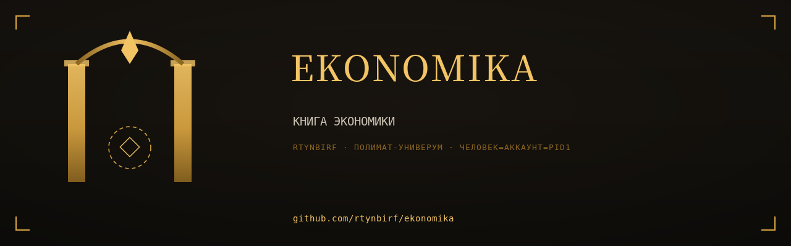
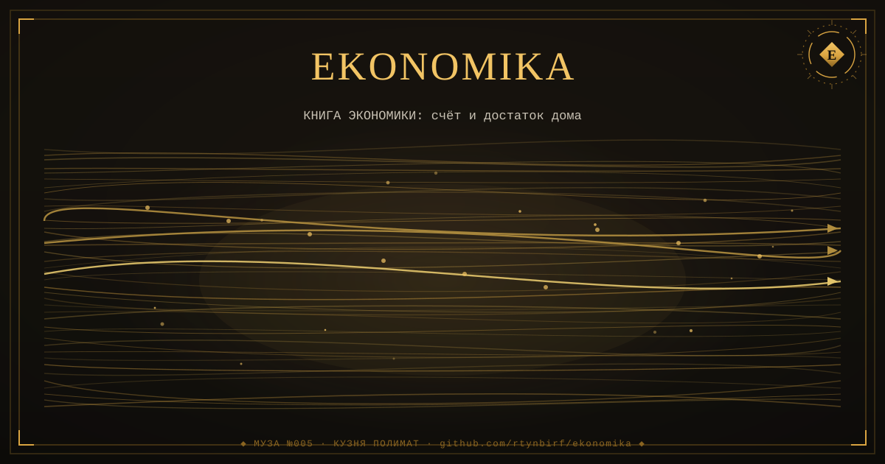

# КНИГА ЭКОНОМИКИ

  

<!--ФОРЖ:МУЗА:НАЧАЛО-->

  
   
  

<!--ФОРЖ:МУЗА:КОНЕЦ-->

> Собрана 2026-11-11 из 2 репозиториев аккаунта rtynbirf. Каждая глава — снимок `main` оригинала на дату сборки (см. `PROVENANCE.md` внутри главы). Оригиналы архивированы read-only, история коммитов сохранена там.

## Оглавление

| Глава | Источник | Файлов | Коммитов в ориг. | Снимок |
|---|---|---|---|---|
| [red-thread-debt-audit](glavy/red-thread-debt-audit/) | [оригинал](https://github.com/rtynbirf/red-thread-debt-audit) | 212 | 48 | `9b72ba0` |
| [rent-mechanism-q43](glavy/rent-mechanism-q43/) | [оригинал](https://github.com/rtynbirf/rent-mechanism-q43) | 87 | 45 | `139d44d` |

## О чём эта книга

Книга: экономика одним томом — КРАСНАЯ НИТЬ (аудит суверенного долга) и Рентный механизм Q43 (шесть законов L1-L6). Собрано из 2 репозиториев rtynbirf.

## Как читать

Каждый каталог в `glavy/` — самостоятельная глава со своим README (если оно было в оригинале). Оглавление главы не переименовывалось: имена совпадают с именами исходных репозиториев, чтобы работали старые ссылки в документах.

<!--ФОРЖ:ПОДВАЛ-->
---

  ◆ картина и штандарт — ручная ковка <a href="https://github.com/rtynbirf">КУЗНИ ПОЛИМАТ</a> · ЧЕЛОВЕК=АККАУНТ=PID1 ◆

